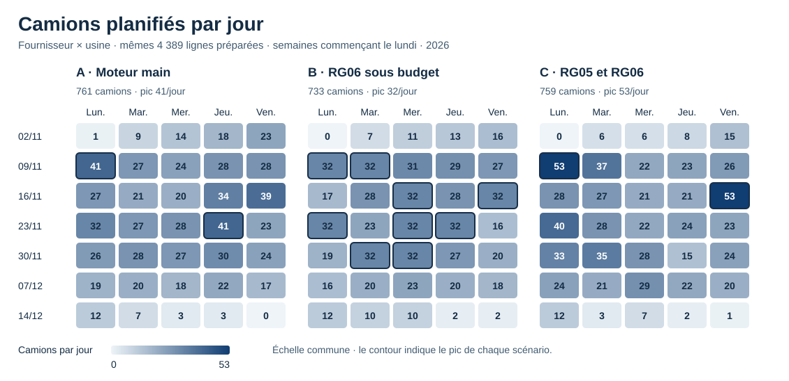

# Plan final fournisseur × usine

Le plan RG05 et RG06 à 53 camions au pic présenté ci-dessous a été suivi d’un essai ciblé, qui ramène le pic à 49. Consulter la [présentation PDF actualisée](presentation-ensemble.pdf) et les [nouveaux exports](ensemble-cible/).

Les deux variantes couvrent les **4 389 lignes préparées de `main`**. Les imputations de cette préparation sont indiquées dans les affectations. La référence quotidienne reconstruite est de **176 724,61 € pour 1 741 camions**.

| Plan | Camions | Plus haut total quotidien | Coût calculé | Économie face à la référence |
|---|---:|---:|---:|---:|
| `main` publié, `c069c90` | 761 | 41 | 110 329,59 € | 66 395,02 € |
| **RG06 stricte sous le coût de `main`** | **733** | **32** | **110 314,80 €** | **66 409,81 €** |
| **RG05 et RG06, coût minimum dans le vivier testé** | **759** | **53** | **111 708,13 €** | **65 016,48 €** |

## Comment le plan est construit

1. **Préparer les candidats.** Reprendre le calendrier du solveur de `main`, celui de Wissam et celui de notre heuristique recalculée sur les mêmes données. Ajouter des propositions par plus court chemin pour couvrir les besoins entre deux départs successifs.
2. **Recharger et chiffrer de la même façon.** Affecter les lignes entières aux camions du même couple, avec 24 500 kg et 110,4 m³ au maximum. Calculer le tarif d’après le poids chargé et la distance.
3. **Appliquer les règles.** RG06 stricte affecte chaque besoin au dernier départ du couple à sa date ou avant, avec au plus sept jours d’avance. Le contrôle RG05 ajoute l’obligation d’avoir au moins une semaine qui utilise tous les jours retenus dans le profil. Le plan sous budget passe RG06, avec 56 couples qui ne passent pas ce contrôle supplémentaire de RG05.
4. **Sélectionner un plan par couple.** Le scénario sous budget minimise le pic global au coût de `main` ou en dessous. Comme le vivier ne permet pas de respecter également RG05 sous ce plafond, la variante avec les deux règles retient d’abord le coût le plus faible, puis le pic le plus bas à ce coût. Le prix de ce choix est de **1 378,54 € de plus que `main`**.
5. **Vérifier et exporter.** Chaque variante couvre toutes les lignes sans doublon, respecte les jours ouvrés et les capacités, et conserve l’article, le quai et les indicateurs d’imputation. Les pics se calculent sur l’ensemble des usines. Le comparatif donne aussi le pic de chacune.

Si le rendu exige RG05 au sens du jalon 3 et RG06 à la lettre, présenter **53 au pic et 759 camions**. Si le plafond de coût de `main` prime avec RG06 stricte, retenir **32 au pic et 733 camions**. Les résultats concernent le vivier exploré. Le calcul de la fréquence selon RG07 reste un sujet distinct.

## Fichiers du dossier

- [Comparatif complet](ensemble-final/comparatif.csv) et [calendrier quotidien](ensemble-final/calendrier.csv)
- [Plan à 32, camions](ensemble-final/rg06-camions.csv) et [affectations](ensemble-final/rg06-affectations.csv)
- [Plan à 32, profils et économies par couple](ensemble-final/rg06-profils.csv) et [économies par usine](ensemble-final/rg06-usines.csv)
- [Plan à 53, camions](ensemble-final/rg05-rg06-camions.csv) et [affectations](ensemble-final/rg05-rg06-affectations.csv)
- [Plan à 53, profils et économies par couple](ensemble-final/rg05-rg06-profils.csv) et [économies par usine](ensemble-final/rg05-rg06-usines.csv)

La [commande de reproduction](README.md#dossier-final-fournisseur--usine) régénère les candidats complémentaires et les exports. Les calendriers publiés de `main` et de Wissam restent des entrées de ce calcul.
