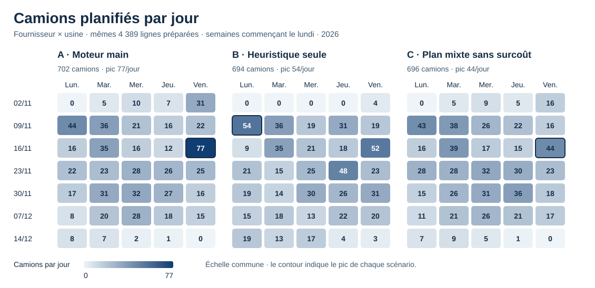

# Testbed de planification fournisseur → hub

## Plan mixte fournisseur × usine

Sur les **4 389 lignes préparées** du jalon 3 de `main` (`db269fc`), le plan mixte réduit le pic de **77 à 44 camions par jour** et coûte **59,92 € de moins** que le plan `main`. Il couvre les mêmes besoins et conserve les imputations du jeu préparé, identifiées dans les affectations.



| Scénario | Coût calculé | Camions | Pic par jour |
|---|---:|---:|---:|
| Référence quotidienne reconstruite | 176 724,61 € | 1 741 | 118 |
| Moteur de `main` | 107 367,96 € | 702 | 77 |
| Heuristique seule | 108 637,92 € | 694 | 54 |
| **Plan mixte sans surcoût** | **107 308,04 €** | **696** | **44** |
| Plan mixte au pic minimal | 107 384,41 € | 697 | 43 |

Pour chaque couple, le calcul choisit l'un des deux plans existants et conserve toutes ses affectations. Il minimise le pic de camions sur le calendrier global sous un plafond de coût, puis cherche le coût le plus bas au pic atteint. Le plan retenu reprend l'heuristique pour 48 des 180 couples. Le pic de 43 est le plus bas dans cet ensemble de plans et coûte 76,37 € de plus que le plan à 44.

Le plan à 44 présente **69 416,57 € d’économies calculées** par rapport à la référence reconstruite. Le run local vérifie la couverture, les charges, les capacités et les dates d’affectation. Il reconstruit l’heuristique et combine ses résultats avec le plan solveur déjà publié par `main`.

[Comparatif et budgets](comparatif-lissage.csv) · [Camions du plan mixte](plan-mixte/camions.csv) · [Affectations du plan mixte](plan-mixte/affectations.csv)

### Reproduire le lissage

Depuis la racine du dépôt, avec Python, pandas, NumPy et SciPy. Récupérer aussi l'historique de `main` si le clone ne contient que `prime`. La révision du jalon 3 est fixée à `db269fc`.

```powershell
git fetch origin main
$env:PYTHONPATH = 'src'
python milestone2/planification_testbed/lissage_duel.py
python milestone2/planification_testbed/heatmaps.py --lissage results/duel-db269fc/lissage/calendrier.csv
```

Les résultats détaillés et le chronomètre sont dans `results/duel-db269fc/lissage/`.

## Testbed hub initial sur charges et distances d'origine

Le testbed du Milestone 2 compare une référence quotidienne reconstruite, des profils fournisseur × usine et des profils fournisseur → hub sur les mêmes 4 251 lignes à charge et distance d'origine. Le [document pas à pas](../ALGORITHME_PLANIFICATION.md) explique les règles, le tarif, la construction des plans et leur validation.

Le [comparatif de référence](comparatif.csv) contient le résultat local. Le scénario hub utilise 338 camions et présente un écart calculé de 86 558,67 € avec la référence. Le processus complet a pris 10,55 secondes sur le poste de test.

La [carte de chaleur des camions par jour](heatmap-camions.svg) compare A, B et C sur un calendrier et une échelle communs. Pour la régénérer après le run, exécuter `python milestone2/planification_testbed/heatmaps.py`.

Ce run s'appuie sur les entrées de `79d34ff`, notamment `data/schedule_clean.csv`. Le `main` plus récent emploie une autre préparation et a retiré ce fichier. Les chiffres de cette publication décrivent le jeu figé sur `prime`.

## Reproduire

Depuis la racine du dépôt avec Python, pandas et NumPy, par exemple dans PowerShell.

```powershell
$env:PYTHONPATH = 'src'
python -m delivery_schedule_optimization.fast_plan --output results/fast_plan
```

Le [point d'entrée Python](../../src/delivery_schedule_optimization/fast_plan.py) vérifie la couverture, les capacités et les dates avant d'exporter les affectations, les camions et le bilan. Les affectations détaillées sont générées à l'exécution.
